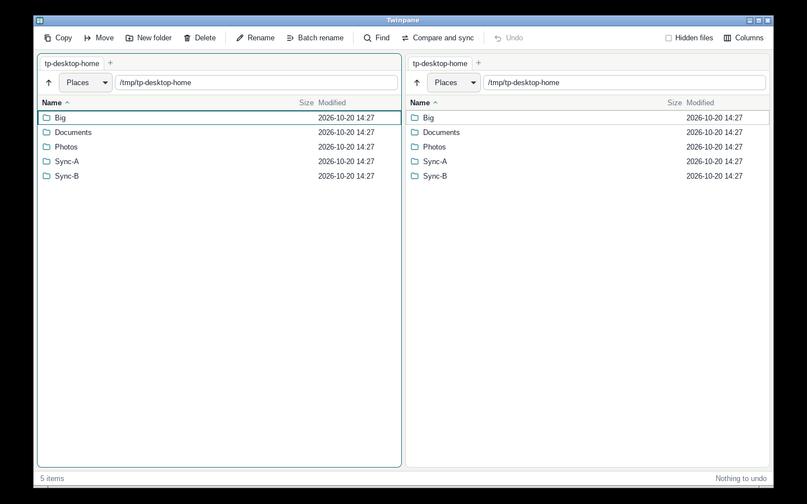

# Twinpane

A power-user, keyboard-first dual-pane file manager for Windows and macOS (and Linux),
built to close the gap people describe between Directory Opus and anything on the Mac:
sortable **EXIF Date Taken** columns, **regex batch rename**, a **regex finder**, and
**folder compare and sync**, all with a preview before anything changes and **undo for everything**.

This is an original implementation. It copies no code, assets, names or interface design from
any other product.



## What it does

| | |
|---|---|
| **Two panes, tabs, keyboard first** | Tab switches pane. Arrow keys, PageUp/Down, Home/End, type-ahead, Space to toggle selection, Shift for ranges. Drag between panes (Ctrl to copy). |
| **Metadata columns** | Date taken, camera, size, modified, type. Sort by any. Files without a value always sort last. |
| **Batch rename** | A chain of rules: find/replace (plain or regex with `$1` groups), insert text, change case, trim. Tokens such as `{n:3}`, `{taken:%Y%m%d_%H%M%S}`, `{camera}`, `{parent}`. A live preview highlights what changes and flags conflicts (duplicates, name already exists, missing EXIF data). It refuses to apply while any conflict remains. Swapping two names works. |
| **Find** | Name as text, wildcard or regex; type, extension, size, modified date, **date taken**; search inside files. Results open in a tab you can copy, move, rename and delete from. |
| **Compare and sync** | Update, Mirror or Two-way. A dry-run table shows exactly what will happen first. |
| **Auto-sync** | In the Compare and sync window, choose **Keep in sync automatically**. Twinpane then re-runs that sync every few seconds in the background until you click **Auto-sync on · Stop** in the toolbar. Each automatic run is one undo step, and Mirror mode asks you to confirm first. |
| **Safety** | Nothing is permanently deleted. Deletes, overwritten files and undone copies go to a holding area. Every operation, including a whole sync or batch rename, is **one undo step**, and undo survives restarting the app. |

### Shortcuts

| | | | |
|---|---|---|---|
| `Tab` switch pane | `F2` rename | `F5` copy | `F6` move |
| `F7` new folder | `F8` / `Del` delete | `Ctrl+R` batch rename | `Ctrl+F` find |
| `Ctrl+Shift+S` compare and sync | `Ctrl+Z` undo | `Ctrl+A` select all | `Ctrl+L` path bar |
| `Ctrl+T` / `Ctrl+W` tabs | `Ctrl+Tab` next tab | `Backspace` parent | `Alt+←/→` history |
| `Ctrl+H` hidden files | `Space` toggle select | `Shift+↑/↓` extend | type to jump |

On macOS, `Ctrl` is `⌘`.

## Download (macOS)

Don't want to build it? Grab the ready-made installer: **[Twinpane.dmg](https://github.com/Blyp0/twinpane/releases/latest/download/Twinpane.dmg)**
(or see the [releases page](https://github.com/Blyp0/twinpane/releases)). Open the DMG and drag Twinpane to
Applications. The app is unsigned, so the first time, right-click it and choose **Open**.

## Build and run

You need [Rust](https://rustup.rs) (1.77 or newer). Then the desktop app:

```sh
cargo install tauri-cli --version "^2" --locked
cd src-tauri
cargo tauri dev        # run it
cargo tauri build      # make an installer
```

Platform notes: Windows needs the WebView2 runtime (already on current Windows 10/11).
Linux needs `libwebkit2gtk-4.1-dev libgtk-3-dev libsoup-3.0-dev libayatana-appindicator3-dev librsvg2-dev`.
The icons in `src-tauri/icons` are generated placeholders; replace them with `cargo tauri icon your-icon.png`.

### Try the UI in a browser, safely

```sh
cargo run -p twinpane-dev -- --root /path/to/a/practice/folder
# open http://127.0.0.1:8731/
```

This runs the real engine, but every path is confined to the folder you give it, it listens on
localhost only, and API calls need a per-run token. Opening files in other apps is disabled.
A ready-made practice folder: `python3 tests-ui/make_sandbox.py /tmp/tp-sandbox`.

## Tests

```sh
cargo test                       # 111 tests: engine, safety rules, command layer, sandbox
cd tests-ui && npm install       # once
CHROME=/path/to/chrome ./run.sh  # 19 end-to-end steps: real key presses in a real browser
```

The engine tests include a hand-built JPEG with real EXIF data, and the safety-critical logic was
mutation-checked: deliberately breaking it (making Update mode delete files, making delete
permanent, removing the into-itself check, allowing path traversal in sync, and so on) makes the tests fail.

## How it is organised

```
core/        twinpane-core: the file engine. No UI, no global state.
  ops.rs       copy/move/delete/rename/mkdir, holding area, undo
  metadata.rs  EXIF date taken, camera, size; metadata rows and sorting
  rename.rs    rule chain, tokens, preview plan, conflict detection
  search.rs    the finder          sync.rs  compare and sync
  api.rs       one JSON command layer (+ optional sandbox) used by both front ends
src-tauri/   the desktop shell: a few lines that forward UI calls to core::api
ui/          the interface: plain HTML, CSS and JavaScript, no build step
devserver/   the sandboxed browser preview
tests-ui/    end-to-end browser tests
```

## Known limitations

* **Deleting large files on a different drive is slow.** The holding area lives in the app's data
  folder, so deleting across drives is a copy then a delete. A holding folder per drive is the fix.
* **Tested on Linux only.** Everything above was run on Linux. The Windows and macOS builds,
  Windows hidden-file attributes, copying symlinks on Windows, and moving across drives are written
  but unverified. Please try them and report what breaks.
* **Quick compare** treats same-size, same-timestamp files as identical; use "Compare file contents".
* **Two-way sync** cannot tell a deletion from a new file, so it never deletes.
* **Undo log** paths must be valid UTF-8.
* Not built yet: remote (FTP/SFTP/cloud), archive browsing, scripting, themes, a duplicate finder,
  right-click menus, and drag and drop from or to other applications.
